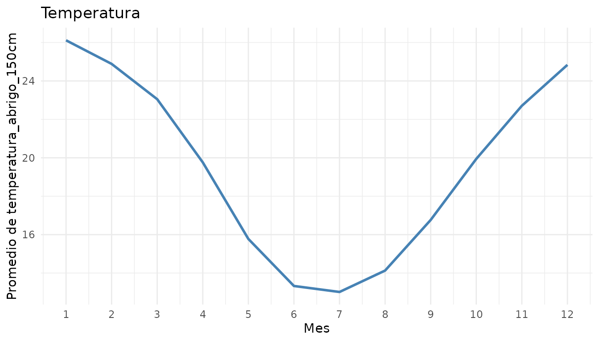
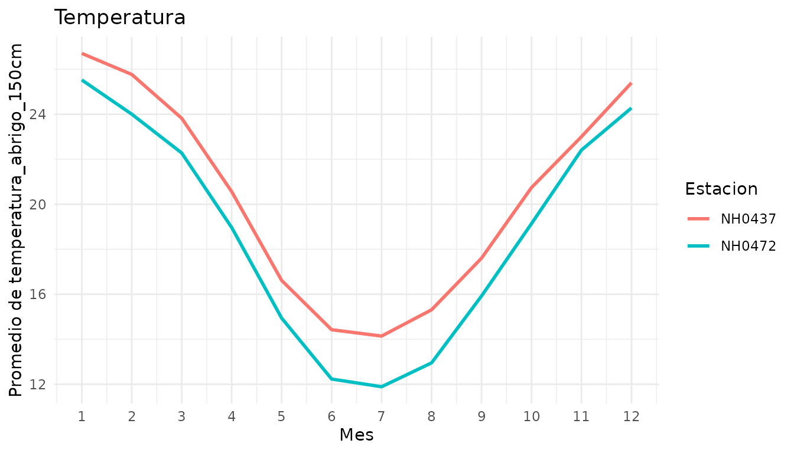
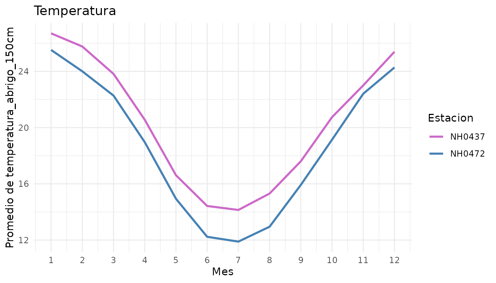
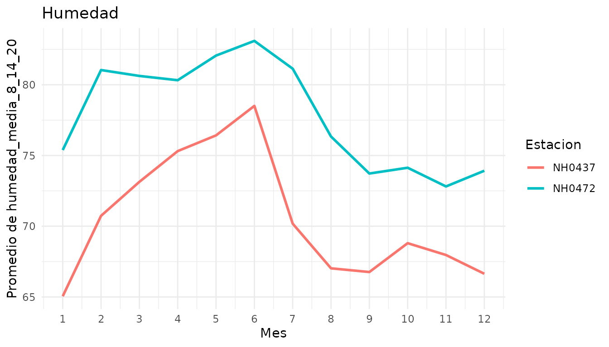
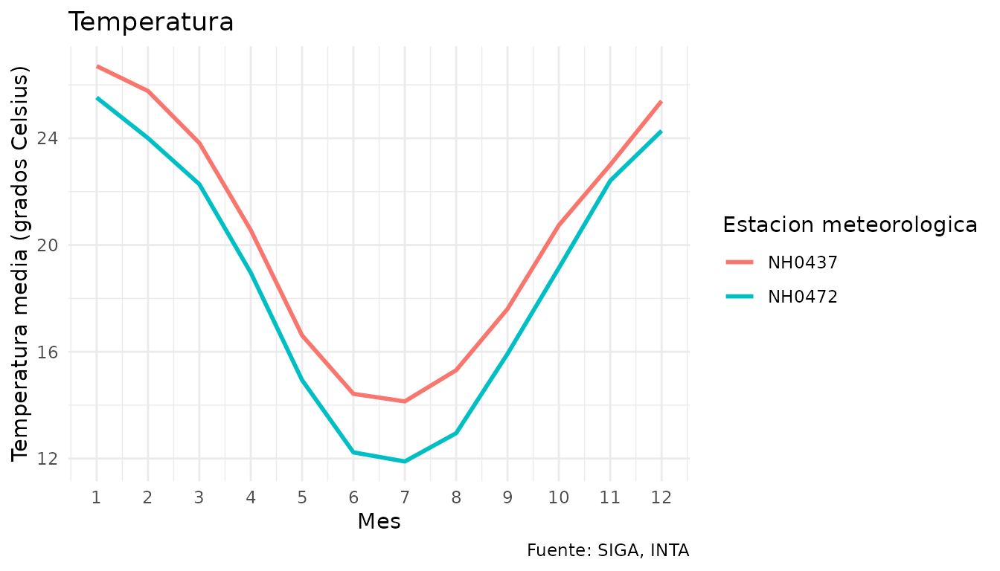
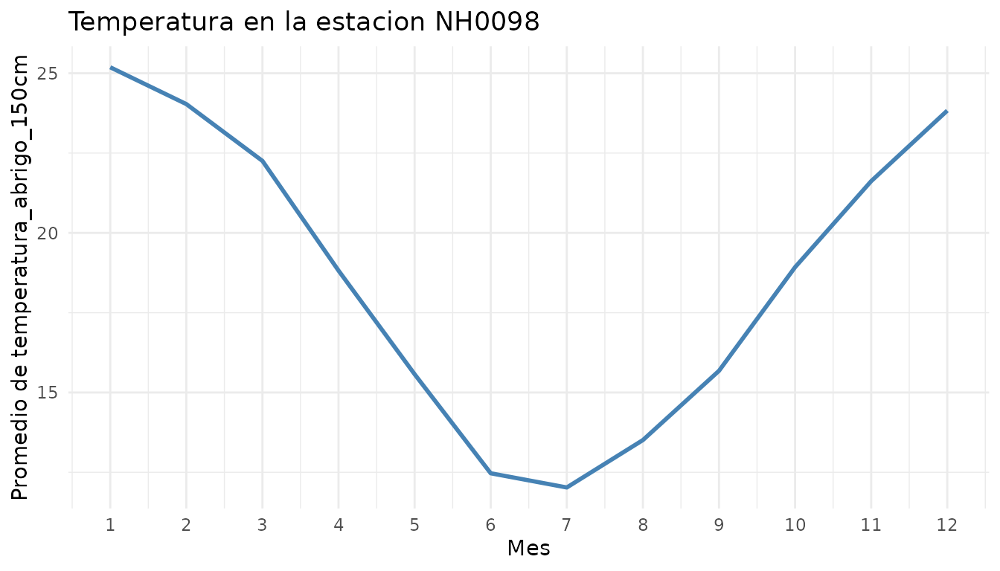

# Introduccion a climatech

climatech es un paquete para trabajar con datos de estaciones
meteorologicas. Permite descargar y leer los datos de una estacion,
resumir cualquier variable numerica mes a mes y graficar su promedio
mensual, tanto para una estacion como para varias a la vez.

Por defecto, el paquete trabaja con datos de estaciones del Instituto
Nacional de Tecnologia Agropecuaria (INTA), disponibles en el Sistema de
Informacion y Gestion Agrometeorologica (SIGA).

Esta vineta muestra el recorrido completo: explorar los datos de
ejemplo, resumirlos, graficarlos y, por ultimo, descargar datos de otra
estacion.

``` r

library(climatech)
```

## Los datos de ejemplo

El paquete incluye `datos_estaciones`, un conjunto de datos con
mediciones diarias de dos estaciones del INTA en la provincia de Santa
Fe, entre 2004 y 2013:

- **NH0437**: INTA Reconquista, en el norte de la provincia.
- **NH0472**: INTA Oliveros, en el sur de la provincia.

``` r

head(datos_estaciones)
#>       id      fecha temperatura_abrigo_150cm humedad_media_8_14_20
#> 1 NH0437 2004-01-01                    19.85                    65
#> 2 NH0437 2004-01-02                    22.20                    65
#> 3 NH0437 2004-01-03                    25.20                    71
#> 4 NH0437 2004-01-04                    29.05                    76
#> 5 NH0437 2004-01-05                    28.45                    68
#> 6 NH0437 2004-01-06                    28.70                    77
```

Cada fila es un dia de una estacion. Ademas de `id` y `fecha`, tiene dos
variables: `temperatura_abrigo_150cm` (temperatura en grados Celsius) y
`humedad_media_8_14_20` (humedad relativa media del dia, en porcentaje).
Podes ver la descripcion completa con
[`?datos_estaciones`](https://moravilar.github.io/climatech/reference/datos_estaciones.md).

Las dos estaciones tienen la misma cantidad de dias:

``` r

table(datos_estaciones$id)
#> 
#> NH0437 NH0472 
#>   3653   3653
```

## Resumir una variable mes a mes

[`tabla_resumen()`](https://moravilar.github.io/climatech/reference/tabla_resumen.md)
calcula, para cada mes del anio, la media, el desvio estandar, el primer
cuartil, la mediana y el tercer cuartil de una variable. Los meses se
agrupan sin importar el anio: el resumen de enero usa todos los eneros
de la serie.

Por defecto resume la temperatura con todos los datos juntos:

``` r

tabla_resumen(datos_estaciones)
#> Hay 1 valor(es) faltante(s) (`NA`) en "temperatura_abrigo_150cm", que no se
#> usa(n) en los calculos.
#> # A tibble: 60 × 3
#>      mes estadistico valor
#>    <dbl> <chr>       <dbl>
#>  1     1 media       26.1 
#>  2     1 desvio       2.86
#>  3     1 q1          24.4 
#>  4     1 mediana     26.2 
#>  5     1 q3          28.0 
#>  6     2 media       24.9 
#>  7     2 desvio       3.13
#>  8     2 q1          22.9 
#>  9     2 mediana     24.9 
#> 10     2 q3          27.0 
#> # ℹ 50 more rows
```

La funcion avisa cuantos valores faltantes (`NA`) hay en la variable.
Esos valores no se usan en los calculos.

El resultado esta en formato largo: una fila por cada mes y estadistico.
Este formato facilita filtrar un estadistico en particular o graficarlo.

Para obtener un resumen separado para cada estacion, se usa
`por_estacion = TRUE`:

``` r

tabla_resumen(datos_estaciones, por_estacion = TRUE)
#> Hay 1 valor(es) faltante(s) (`NA`) en "temperatura_abrigo_150cm", que no se
#> usa(n) en los calculos.
#> # A tibble: 120 × 4
#>    id       mes estadistico valor
#>    <chr>  <dbl> <chr>       <dbl>
#>  1 NH0437     1 media       26.7 
#>  2 NH0437     1 desvio       2.79
#>  3 NH0437     1 q1          25.0 
#>  4 NH0437     1 mediana     26.8 
#>  5 NH0437     1 q3          28.5 
#>  6 NH0437     2 media       25.8 
#>  7 NH0437     2 desvio       3.07
#>  8 NH0437     2 q1          23.8 
#>  9 NH0437     2 mediana     25.6 
#> 10 NH0437     2 q3          27.6 
#> # ℹ 110 more rows
```

Y para resumir otra variable, se indica su nombre en `variable`:

``` r

tabla_resumen(datos_estaciones, variable = "humedad_media_8_14_20")
#> Hay 4 valor(es) faltante(s) (`NA`) en "humedad_media_8_14_20", que no se usa(n)
#> en los calculos.
#> # A tibble: 60 × 3
#>      mes estadistico valor
#>    <dbl> <chr>       <dbl>
#>  1     1 media        70.2
#>  2     1 desvio       13.5
#>  3     1 q1           61  
#>  4     1 mediana      70.5
#>  5     1 q3           80  
#>  6     2 media        75.9
#>  7     2 desvio       12.0
#>  8     2 q1           68  
#>  9     2 mediana      76  
#> 10     2 q3           85  
#> # ℹ 50 more rows
```

## Graficar el promedio mensual

[`graf_prom_mensual()`](https://moravilar.github.io/climatech/reference/graf_prom_mensual.md)
calcula el promedio de una variable para cada mes y lo muestra en un
grafico de lineas. Por defecto grafica la temperatura con todos los
datos juntos:

``` r

graf_prom_mensual(datos_estaciones)
#> Valores faltantes (NA) ignorados en temperatura_abrigo_150cm: 1.
```



Se ve el ciclo anual tipico del hemisferio sur: los meses mas calidos
son diciembre, enero y febrero, y los mas frios, junio y julio.

Con `por_estacion = TRUE` se dibuja una linea para cada estacion, lo que
permite compararlas:

``` r

graf_prom_mensual(datos_estaciones, por_estacion = TRUE)
#> Valores faltantes (NA) ignorados en temperatura_abrigo_150cm: 1.
```



Reconquista (NH0437), que esta mas al norte, es mas calida que Oliveros
(NH0472) durante todo el anio. La diferencia es mayor en invierno: en
julio, el promedio es de unos 14 grados en Reconquista y de unos 12 en
Oliveros.

Los colores de las lineas se pueden elegir con `colores`, indicando uno
por estacion:

``` r

graf_prom_mensual(datos_estaciones, por_estacion = TRUE,
                  colores = c("orchid3", "steelblue"))
#> Valores faltantes (NA) ignorados en temperatura_abrigo_150cm: 1.
```



Para graficar otra variable, se indica en `variable`. Como el titulo por
defecto es `"Temperatura"`, conviene cambiarlo con `titulo`:

``` r

graf_prom_mensual(datos_estaciones, variable = "humedad_media_8_14_20",
                  por_estacion = TRUE, titulo = "Humedad")
#> Valores faltantes (NA) ignorados en humedad_media_8_14_20: 4.
```



En este caso la relacion se invierte: Oliveros es mas humeda que
Reconquista en todos los meses.

El resultado es un grafico de ggplot2, asi que se le pueden agregar
capas con `+`. Por ejemplo, con
[`labs()`](https://ggplot2.tidyverse.org/reference/labs.html) se pueden
cambiar las etiquetas: solo se reemplazan las que se indican y el resto
queda como estaba.

``` r

library(ggplot2)

graf_prom_mensual(datos_estaciones, por_estacion = TRUE) +
  labs(y = "Temperatura media (grados Celsius)",
       color = "Estacion meteorologica",
       caption = "Fuente: SIGA, INTA")
#> Valores faltantes (NA) ignorados en temperatura_abrigo_150cm: 1.
```



## Usar datos de otra estacion

Para trabajar con otra estacion se usa
[`leer_dataset()`](https://moravilar.github.io/climatech/reference/leer_dataset.md).
La funcion descarga el archivo CSV de la estacion, lo guarda en la ruta
indicada y lo lee como tabla. Si el archivo ya existe en esa ruta, lo
lee directamente sin volver a descargarlo.

En este ejemplo se descargan los datos de la estacion NH0098. Se guardan
en una carpeta temporal, que se borra al cerrar R; para conservar los
datos, se puede indicar cualquier otra ruta, por ejemplo
`"datos/NH0098.csv"`.

``` r

ruta <- file.path(tempdir(), "NH0098.csv")
nh0098 <- leer_dataset("NH0098", ruta = ruta)
#> Descargando "NH0098" desde
#> <https://raw.githubusercontent.com/rse-r/intro-programacion/main/datos/NH0098.csv>...
```

Los datos descargados se pueden usar directamente con las demas
funciones del paquete:

``` r

graf_prom_mensual(nh0098, titulo = "Temperatura en la estacion NH0098")
#> Valores faltantes (NA) ignorados en temperatura_abrigo_150cm:
#> 193.
```



Por defecto,
[`leer_dataset()`](https://moravilar.github.io/climatech/reference/leer_dataset.md)
descarga datos de estaciones del INTA. Con el argumento `url_base` se
puede indicar otra direccion, siempre que contenga archivos CSV con el
nombre de cada conjunto de datos.
