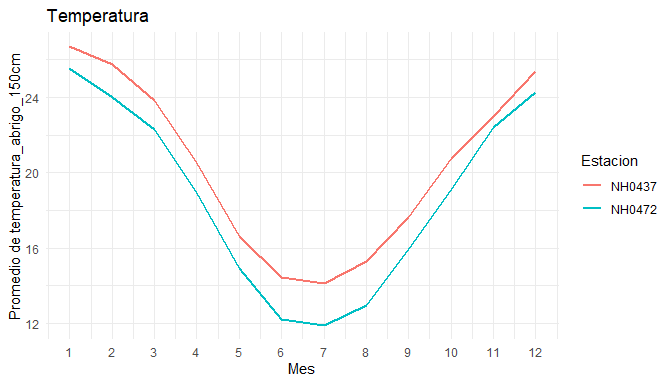

# climatech

climatech permite descargar, resumir y graficar datos de estaciones
meteorologicas. Por defecto trabaja con datos de estaciones del
Instituto Nacional de Tecnologia Agropecuaria (INTA), disponibles en el
Sistema de Informacion y Gestion Agrometeorologica (SIGA).

Con climatech podes:

- descargar y leer los datos de una estacion con
  [`leer_dataset()`](https://moravilar.github.io/climatech/reference/leer_dataset.md);
- obtener un resumen mensual de cualquier variable numerica, para una o
  varias estaciones, con
  [`tabla_resumen()`](https://moravilar.github.io/climatech/reference/tabla_resumen.md);
- graficar el promedio mensual de una variable numerica con
  [`graf_prom_mensual()`](https://moravilar.github.io/climatech/reference/graf_prom_mensual.md).

El paquete incluye ademas `datos_estaciones`, un conjunto de datos de
ejemplo con mediciones diarias de dos estaciones del INTA en Santa Fe,
para probar las funciones sin descargar nada.

climatech fue desarrollado como trabajo practico de la materia
Programacion II de la Licenciatura en Ciencia de Datos (Universidad
Austral). Es un paquete de practica y no esta pensado para usarse en
analisis reales.

## Instalacion

Podes instalar la version en desarrollo de climatech desde
[GitHub](https://github.com/moravilar/climatech) con:

``` r

# install.packages("pak")
pak::pak("moravilar/climatech")
```

## Ejemplo de uso

``` r

library(climatech)
```

Resumen mensual de la temperatura para cada estacion de los datos de
ejemplo:

``` r

tabla_resumen(datos_estaciones, por_estacion = TRUE)
#> Hay 1 valor(es) faltante(s) (`NA`) en "temperatura_abrigo_150cm", que no se
#> usa(n) en los calculos.
#> # A tibble: 120 × 4
#>    id       mes estadistico valor
#>    <chr>  <dbl> <chr>       <dbl>
#>  1 NH0437     1 media       26.7 
#>  2 NH0437     1 desvio       2.79
#>  3 NH0437     1 q1          25.0 
#>  4 NH0437     1 mediana     26.8 
#>  5 NH0437     1 q3          28.5 
#>  6 NH0437     2 media       25.8 
#>  7 NH0437     2 desvio       3.07
#>  8 NH0437     2 q1          23.8 
#>  9 NH0437     2 mediana     25.6 
#> 10 NH0437     2 q3          27.6 
#> # ℹ 110 more rows
```

Promedio mensual de la temperatura, con una linea para cada estacion:

``` r

graf_prom_mensual(datos_estaciones, por_estacion = TRUE)
#> Valores faltantes (NA) ignorados en temperatura_abrigo_150cm: 1.
```



Para descargar los datos de otra estacion, se indica su identificador y
la ruta donde guardar el archivo:

``` r

nh0098 <- leer_dataset("NH0098", ruta = "datos/NH0098.csv")
```

Para ver el uso completo de las funciones, consulta la [vineta del
paquete](https://moravilar.github.io/climatech/articles/climatech.html).
Toda la documentacion esta disponible en la [pagina web de
climatech](https://moravilar.github.io/climatech/).

## Como esta pensado el paquete

Algunas decisiones sobre como funciona climatech, y por que las tomamos.

### La variable se indica como texto

[`graf_prom_mensual()`](https://moravilar.github.io/climatech/reference/graf_prom_mensual.md)
y
[`tabla_resumen()`](https://moravilar.github.io/climatech/reference/tabla_resumen.md)
reciben la variable a analizar como texto, entre comillas:

``` r

graf_prom_mensual(datos_estaciones, variable = "humedad_media_8_14_20",
                  titulo = "Humedad")
```

Otra opcion era que el usuario pasara la columna directamente. Elegimos
el texto porque es mas simple y menos confuso: alcanza con conocer el
nombre de la columna, que se puede ver con `names(datos)`. Ademas, si la
columna no existe, la funcion puede avisar con un mensaje claro cual es
la que falta.

Las dos funciones comparten los mismos argumentos principales (`datos`,
`variable` y `por_estacion`), asi que quien aprende a usar una ya sabe
usar la otra.

### Sin tildes ni enies

Todo el paquete (codigo, mensajes, documentacion y este README) esta
escrito sin tildes ni enies. Para evitar problemas con el `R CMD check`,
y para que todo el paquete sea consistente, decidimos no usarlos en
ningun lado. Sabemos que se lee un poco raro, pero asi el paquete
funciona igual en cualquier sistema. Existe la alternativa de escribir
los caracteres con codigos como `\u00f1` pero el codigo se vuelve mas
dificil de leer.

### `tabla_resumen()` se puede hacer de dos formas:

- con todos los datos juntos (`por_estacion = FALSE`, el valor por
  defecto), aunque haya mas de una estacion;
- por separado para cada estacion (`por_estacion = TRUE`). En ese caso,
  los datos tienen que tener una columna `id` que identifique a cada
  estacion; si no la tienen, la funcion lo avisa con un error.

``` r

tabla_resumen(datos_estaciones, variable = "humedad_media_8_14_20",
              por_estacion = TRUE)
```

Asi la funcion sirve tanto para datos de una sola estacion, que no
necesitan `id`, como para datos de varias.
[`graf_prom_mensual()`](https://moravilar.github.io/climatech/reference/graf_prom_mensual.md)
funciona de la misma manera.

## Autoras

- Castro, Maria del Pilar
- Vilar, Mora
